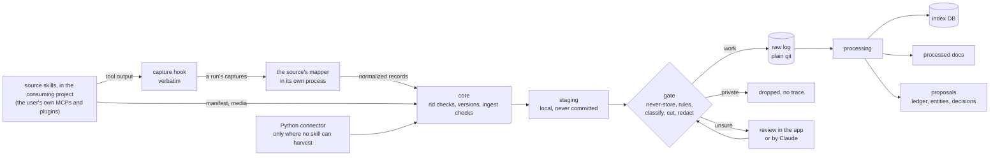
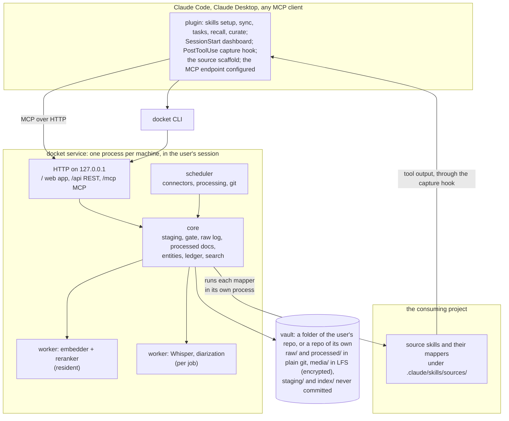

# Docket: the design

Docket is an open-source, Claude-first memory and task manager for one person's working life. It keeps everything they
hear and write at work (mail, calendar, chat, call recordings, Claude sessions, their own documents) twice: **raw**,
exactly as it came, and **processed**, as summaries, notes and a task ledger with meetings, prep, minutes and
follow-ups. On top sit a curated keyword and alias layer, local speech recognition, embeddings and a reranker, and a
web app that runs the day. Claude reaches all of it through an MCP endpoint and a plugin, so any session can find a
sentence said three weeks ago and cite it.

The rule that shapes everything: **a summary is an index into the raw, never a replacement for it.** Read the summary
first, then check every fact you use against the raw it came from. Docket exists because a summary once dropped a
price a colleague named in a call ("10 millió forint"), and only the summary had been kept.

Three parts:

- The vault is the data layer: raw records, media, processed docs, entities and the ledger, in a folder of the
  user's own repo (or a repo of its own), private and in git.
- The service runs it: staging and the gate, the index and search, the web app, the MCP endpoint with its read and
  write tools, the models in worker processes. One per machine, always on, in the user's session. It keeps the source
  contract (record shapes, rid rules, versions) and does the compute: search, transcription.
- The Claude Code plugin feeds and maintains it, through the service's tools: setup, sync, tasks, recall, curate, the
  capture hook and the source scaffold. Its skills write notes and summaries, translate and reconcile, curate the
  keywords and run the ledger; its setup asks what the user wants to set up. The consuming project's own source skills
  do the harvesting, with the user's own MCPs and plugins (see Sources).

The binding choices are decision entries (`uv run docs list decisions`); this page explains how the parts fit.

## 1. What it has to do

| Need | Done when |
|---|---|
| Keep every source raw and processed | every mail, message, event and utterance is in the raw log with a link back to where it came from; every summary names the raw records it covers |
| Summary first, raw for accuracy | every summary line carries an anchor (a record and a time or offset); `verify` pairs each line with its raw span; a correction reaches everything built on the line |
| Keywords and aliases that are kept up | people, projects, customers, sites, products, topics and tickets as entities, with names in each language, nicknames, handles and the ways speech recognition mangles them; upkeep that costs minutes a week |
| Recall that works | a set of real questions finds the right source in the top 10 for at least 90% of them |
| Local speech recognition | Whisper next to the recorder's own transcript, reconciled in context; without a GPU, the source's transcript |
| Embeddings and a reranker | multilingual, behind a provider interface: GPU, CPU, an API, or keyword search alone |
| Sync from anything | call recorders, chat, mail, calendars, Claude sessions and documents; a new source is a skill and a mapper in the user's own project, scaffolded by `docket source new` |
| Memory and tasks | the ledger (owed, waiting, decisions, invites, triage, materials, outcomes), meetings with prep, minutes and outcomes, briefs ready before each meeting |
| Claude first | an MCP endpoint and a plugin with the skills (setup, sync, tasks, recall, curate), the capture hook, the source scaffold and a session-start dashboard |
| In git | everything in the vault is committed after a staging gate; media through LFS, encrypted; the database is rebuilt from what's committed |
| Private stays private | nothing private, uncut or unredacted is ever committed; forgetting removes it for real |
| Local first | Windows, macOS and Linux; every GPU feature optional; no telemetry |
| Several sessions | one service per machine; any number of Claude sessions use it at once |
| Claude inside, optional | on the user's own API key, the service runs processing jobs and the app's buttons without a Claude Code session |

## 2. How big it is

Two hours of recorded calls a working day is about 90 KB of transcript text. A year of raw text from every source is
in the low hundreds of MB, roughly 50 to 100 thousand chunks; a year of audio at 15 MB an hour is about 7.5 GB. That is
small for SQLite and for a GPU (embedding everything again takes minutes) and far beyond any context window, so search
has to be good. Once it has found the right 50 passages, Claude can read all of them in full.

## 3. How it works

### 3.1 Sync, through a staging gate



- Everything lands in `staging/` first, on the local disk, never committed.
- The gate applies, in order: the never-store lists in `vault.yaml` (people, channels, chats, keywords); rules per
  source (a recorder's folder or tag, a work calendar); then, for sources that can carry private content (call
  recordings), a classification by Claude or by the user. Cuts of non-work stretches are applied to the transcript and
  the audio here. Redaction runs here on every text, and again on every derived text later: credentials by default,
  phone numbers and the user's own patterns when the user turns them on, each switched in `vault.yaml` (DR-0190).
  Every rule reads the same text, so what any rule matches on the text as given is redacted whole whatever the order,
  and turning a rule on never unredacts it; matches that overlap become one marker (DR-0525, DR-0526). Names are never redacted; the
  never-store lists keep them out (DR-0194).
- Only then are records written to the raw log and committed. An unclassified record waits in staging; the app
  shows how many. The one version that goes in unstaged is the gate's own cut of one already in raw, made at
  promotion: a Whisper transcript following its family's cuts (DR-0596).
- A held recording goes in only once it is released with the cuts its owner said yes to, at their own terminal or in
  chat to Claude, who runs the release (DR-0600). The release log keeps those cuts, and the gate applies them to every
  version of the recording, on every machine (DR-0200, DR-0201, DR-0203).
- Claude acts with the owner's OK in chat: it releases, changes settings, confirms decisions and old cuts by running
  the owner's own commands after their yes, which Docket doesn't check; each commit says who acted. Only forgetting
  for real and turning credentials redaction off keep the owner's yes at their own console (DR-0599).
- Cursors are a high-water mark plus a lookback window plus a retry set and a waiting set per source, so late
  arrivals and rate-limited calls are caught on the next run. Each machine commits its own cursor file,
  `state/cursors-<machine>.yaml` (DR-0245), and a run's window starts at the furthest mark any machine reached, less
  the source's lookback: its `lookback_days` in `vault.yaml`, such as a day for chat and mail, else a week (DR-0606,
  DR-0607). The mark moves only on a whole close, to the moment the run opened: a listing is newest first, so moving
  it on partial progress would skip the older part for good. What a run skipped waits in the retry set, what its
  mapper still waits for in the waiting set, and both pass to another machine (DR-0247).
- Source skills don't retype anything. A sync run (DR-0240) goes:

  | Step | Who | What |
  |---|---|---|
  | open | Claude | `run_open(source)`: the run, its window, the source's skill, what to skip and what is owed, the steps |
  | bind | the capture hook | ties the run to the Claude Code session that opened it |
  | fetch | Claude | the source's own tools, as its skill says, within the run's budget |
  | capture | the capture hook | posts each listed call's input and result as given into the service's memory |
  | close | Claude | `ingest(run, captures)`, the count being the highest the hook confirmed |
  | map | the service | the source's mapper in its own process, then the core's checks, holds and the gate into staging |

  A run that comes up short, fails or never closes is dropped, nothing of it is staged, and its window is fetched
  again. Ids that waited a week get a final run of their own, `run_open(source, final=true)`, which never moves the
  mark (DR-0252). A Python connector exists only where no skill can harvest (see Sources).

### 3.2 Processing

Each step is idempotent, records the engine and version it used, and can be re-run over everything.

1. Normalize: plain text, language, quoted mail history and signatures stripped (kept in raw).
2. Speech: Whisper, optional diarization, then the two transcripts reconciled in context (see Speech).
3. Chunk (see Search). Both raw transcripts and the reconciled one are chunked; hits on the same stretch collapse.
4. Tag: entities by alias, typed extractors (tickets, amounts, dates), speakers to people.
5. Embed.
6. Link: recordings and chats to meetings by time (the meetings come from the calendar, keyed by the event's id);
   records to the ledger items whose source points at them.
7. Summarize, with Claude: recording notes, thread summaries, digests, each line with its anchors.
8. Propose: ledger items, closes, minutes, decisions, entities and aliases. Proposals go to review in tiers (see Keywords and aliases).

### 3.3 Recall: summary first, raw for accuracy

```mermaid
sequenceDiagram
  participant U as The user or a task
  participant C as Claude
  participant D as docket (MCP)
  U->>C: what did Marco say the consultant would cost?
  C->>D: search("consultant cost", boost people=[marco], since=2026-10-01)
  D-->>C: hits with locators, grouped by recording or thread, each with its summary
  C->>D: read(note, view=summary)
  C->>D: verify(note, lines=[4, 9])
  D-->>C: each line next to its raw span
  C-->>U: the answer, quoted, with locators; a mismatch is said and logged as a correction
```

- `verify` is mechanical because every line carries anchors: `@12:08` within a single-record note, or `[r:<rid>@12:08]`
  when a doc covers several records; `[r:<rid>#2]` points at a paragraph of a mail or message and `[r:<rid>]` at a whole
  record (DR-0198). An anchor on a folder source's record that went resolves against its last version with text, and
  names where the file moved (DR-0491).
- People and entity filters are boosts with a fallback, not hard filters: an unlabelled speaker would otherwise drop
  the very chunk that holds the answer.
- A correction propagates. Every ledger item, decision and brief line records what it was built from
  (`derived_from`). A correction is a new version of the doc (its next rev, DR-0112), and its dependents are flagged
  for review.
  - A line cites the doc line it was built from as `[d:<doc id>@<rev>#<n>]`, the token `verify` gives as each line's
    `cite`; doc_put pins it to the first 8 hex digits of the sha256 of that line's text, its anchors left out
    (DR-0540).
  - A ref is flagged when the line it cites reads otherwise in its doc's current rev, or that doc is gone or
    superseded: `read` says so beside the line, `docket doc stale` lists it, and the session start counts it. Only
    direct dependents are flagged, and a flag clears when the line is cited afresh or its ref dropped (DR-0542).
  - A mismatch `verify` shows becomes a `correction` doc (each line the raw's anchor and a ref to the line it
    corrects), then the doc's next rev, which is what flags the dependents; the correction counts as not applied until
    that line changes (DR-0543).
  - A forget drops a line's dependents instead of flagging them: a line built on a line the forget drops goes with
    it in the doc's next rev, to a fixed point, so nothing of what was forgotten stays flagged in a brief (DR-0580).

### 3.4 Tasks

The ledger keeps owed and awaited items with kinds, triage verdicts (discuss, claude, chase, me), snooze, materials,
notes and an outcome per item, a dated log, meetings with talking points and outcomes, streams, batch operations, and
archiving after closing. Every item's source resolves to a raw record; the history is queryable ("how many asks to
Marco went unanswered"); time-driven changes (rollover, archiving) are written as explicit ops, so rebuilding gives the
same result on any day.

- Each change to an item is an op: one JSON line in `ledger/ops/<yyyy-mm>-<machine>.jsonl`, written once and merged
  by union, saying who made it, `user`, `claude` or `sync` (DR-0610, DR-0611). An item folds from its own ops.
- Undo is an op that leaves one op out of the fold, and an undone undo puts it back; archive is a flag on a closed
  item that keeps its history (DR-0614, DR-0615). `docket vault check` names what the fold leaves out (DR-0617).
- A forget masks an op in place, the one change a committed line takes: its id, keys and structure kept, its text
  `[forgotten]`, its locators `[forgotten:<32 hex>]`. The list names it, so every reader of the ledger reads it masked
  at once and each clone's next gate call writes the mask (DR-0693, DR-0695, DR-0696).
  - It masks an op anchoring on the family or naming it as a locator, and every op of an item or a meeting whose
    making op it masks: a shell, kept with its number. A point's copies go with it only when its words are its own;
    every clone matches again, so its own ops from before its pull go too (DR-0694).
  - The writer refuses text or a log on a shell and a locator or an anchor on what was forgotten, and writes a note
    or an outcome there as `[forgotten]`; the import refuses a line bringing text back onto a shell (DR-0696).
- Meetings and streams are objects in the same files: an add, a meeting or a stream op whose item is its own id makes
  one, and an object of a kind this Docket doesn't know is kept and changes nothing (DR-0620). The adds of one key, a
  meeting's event or a stream's name, are one object, and a keyed add may continue a meeting that had none, whose id
  and M- number hold (DR-0621, DR-0622). Talking points are ops on their meeting; a roll copies a point to the next
  meeting of its series, and rollover and a meeting's archive are ops the writer writes (DR-0623, DR-0624).
- The index holds the folded ledger (DR-0616, DR-0628). A meeting folds with its part, the meetings tied to it by a
  key, a join or a roll, so an update and a write fold only the parts their ops touch (DR-0633). `suggest` reads what
  is worth raising in a meeting from the same tables (DR-0629, DR-0634).
- Changes come as a batch, from Claude's `ledger_batch` or `docket ledger batch`: every change or none, each saying
  who, `as` naming what one made for a later change's `$name`, a point's n as the batch began; a dry run lists every
  refusal. An add like an open item and a keyless meeting doubling one are refused (DR-0637, DR-0639 to DR-0642).
- Reads come from Claude's `ledger` or `docket ledger snapshot`, `show`, `queue`, `list`, `meetings` and `suggest`, off
  the same tables: counts first, then a line per item, meeting, point or stream, each source a locator; notes, outcomes
  and the history only in `show`; an item's counts from its ops, never its log's words (DR-0638, DR-0643, DR-0644,
  DR-0660).

- Meetings come from the calendar. The core turns its records into meeting ops keyed by the event's own id (iCalUId or
  the provider's id), plus the occurrence's original start for a recurring event, so a moved, renamed or cancelled
  meeting updates the same meeting; nothing is matched on start time plus subject.
  - A record of kind `event` is one occurrence: its rid is the meeting's event, and the core reads its thread, times,
    title, author, `to` and its text's header, `Where:`, `Response:` and `Cancelled` (DR-0646, DR-0648).
  - After each promotion the event records it wrote become one write by sync that never refuses; a step that stopped
    is replayed first, and `docket ledger calendar` catches up by adding and joining, in writes of whole days (DR-0647).
  - A record joins the unkeyed meeting with its start and subject, as todo.py's update did, so an old meeting keeps
    its number; the owner's undo asked by `of` is kept, one asked by `batch` is as if never (DR-0649, DR-0652).
  - Recordings and asks link to meetings by time through the ledger's window read, written by the sync (DR-0651).
- A stream can have a STATUS.md in the user's repo, at the path `vault.yaml`'s `rendered` names with kind `status`
  (DR-0673). Its frontmatter is rendered from the ledger: todo.py's six fields and a line hashing them; the body below
  is the owner's, kept byte for byte (DR-0674). It renders after each write that changes the stream, once the lock is
  let go, and on `docket render`, never committed and never into a public repo. A hand edit is left and reported
  until the two agree, and `docket vault check` names it, a file that lags and a stream the ledger lacks (DR-0675).
- The session start shows the owner's day, todo.py's dashboard from one snapshot read and the Sync page's due rule:
  the syncs due, the queue, today's and the next working day's meetings with their points and items, then overdue,
  replies, decisions and tasks, invites, waits and streams, an item listed once among them (DR-0670). It comes whole
  only in a session whose own repo is the vault's, else as one line of counts (DR-0671), in at most 45 lines, cut from
  the streams up and given back to the room; the hook waits 3 s for the service and never folds the ledger itself
  (DR-0672). `docket ledger day` prints the same from the vault.
- The plugin's sync writes into the ledger: its agents report from what raw keeps after their own promotion, and one
  batch by `sync` closes on evidence, logs or adds the asks, sets and links meetings, writes minutes, rolls over,
  proposes points and moves streams, with no proposal queue (DR-0686, DR-0689). The writer refuses a `source` or a
  material's `ref` pointing into a never-store container, by a Slack or Teams rid's text or the index's container and
  thread for any rid (DR-0690).
- The plugin's tasks works the queue the owner triaged on the page, in chat, one item at a time, each outcome one
  batch before the next, by `claude` for what Claude did and by `user` for what the owner decided; the page and the
  chat share only the ledger (DR-0691).

### 3.5 Beyond search

| Feature | How it works | Phase |
|---|---|---|
| Briefs | a processed doc per entity, `brief:<entity id>`: what changed, the last conversations, the decisions, in three fixed sections, every line cited (DR-0555); stale when its entity's records sit in run files its last rev's tree lacks, or a line is flagged (DR-0556); never for a listed entity, never naming a listed person (DR-0558); rebuilt by the brief skill when the user asks. Open items wait for the ledger, and a brief before each meeting for the calendar's meetings (phase 3) | 2 |
| Decision log | a processed doc per decision, `decision:<yyyy-mm-dd>-<words>`, on a project, topic or stream entity (DR-0563): Claude proposes candidates with the decision skill; only the user confirms or rejects one, by their click on the Briefs page or their word in chat, which Claude writes with `docket decision set`, and every read takes a decision's status from git (DR-0603); a proposed one never reads as decided, and a brief's Decisions cite current decisions only (DR-0565); a contradiction is marked, never resolved by the machine; a later decision supersedes an earlier one, and history stays | 2 |
| Own documents | the work folder and attachments, read-only, so search covers what was written next to what was said: `docket scan` reads a folder source's docx, xlsx, pptx, pdf, md and txt as text, by page, slide and sheet (DR-0480) | 1 |
| Highlights | a recorder's highlight button and later a hotkey; marked stretches go to the top of the minutes | 1 |
| Secrets | never in the vault; a keychain-backed `docket secret`, never indexed or sent to a model unless asked for by name | 2 |
| Outbox | drafts Claude prepared, on one page for the user's click; nothing is sent by the app | 3 |
| The user's voice | a recurring edit to Claude's drafts is proposed as a rule into the user's style file | 4 |
| Phone | Today, Queue and Outbox over Tailscale with the owner's identity; never on the open internet | 4 |

## 4. Architecture



### 4.1 The service

- One process per user, in the user's session, installed by `docket service install`: a task started at logon
  on Windows, a LaunchAgent on macOS, a systemd user unit on Linux (DR-0154). Not a system service: the recorder needs
  the user's audio devices, and the keychain, git credentials and GPU are the user's.
- It serves the web app, a REST API and the MCP endpoint on one 127.0.0.1 port, 8741 unless the user's config says
  otherwise (DR-0151). The plugin registers it with Claude Code.
- It runs its writes one at a time. Every Claude session and the app go through it; the CLI writes directly, under
  the same vault lock the service takes, whether the service runs or not (DR-0153).
- Models run in worker processes, each in its own environment: the embedder and reranker stay loaded (DR-0330,
  DR-0332), and a command that only asks queries starts one for itself; Whisper starts per job and ends, freeing its
  VRAM, and its CUDA libraries never share a process with another worker's.
- Or, per machine, Voyage AI's API for the embedder and reranker, in process (DR-0536): only when the vault allows it in
  `vault.yaml` (DR-0537), the machine chose it and its key is in the keychain (DR-0539), and only what passes a screen
  of the vault's settings in force: chunks of the index whose sources are still there and not private, past the
  never-store lists and the redaction rules, and queries past the same lists (DR-0538).
- Security on localhost (DR-0152): bound to 127.0.0.1; every request's Host checked; the browser gets a session
  cookie (SameSite=Strict) from a one-time link `docket open` opens, and only the web app's static files go without
  it (DR-0177); every write checks Origin and Sec-Fetch-Site;
  the API and MCP take a bearer token from the keychain, or from a file only the user can read where there is no
  keychain; the MCP endpoint also uses the MCP SDK's DNS-rebinding protection. The service runs the consuming repo's
  mappers, never code from the vault, a downloads folder or a drop folder.
- Sync runs live in the service's memory from `run_open` to `ingest`, and nothing of a capture is written to disk or
  to a log (DR-0240). Each run that ends, whole or dropped with its kind (DR-0302), leaves a line of ids and counts in
  the vault's private folder, `sync/runs.jsonl`, which only the Sync page reads (DR-0301). The run routes under `/api/runs` take the bearer token only, never the browser's session, and a
  capture only from the session its run is bound to, within caps (DR-0243). A close maps on a thread of its own for at
  most 90 seconds, under the plugin's 120-second tool timeout, and writes through the writer (DR-0244).
- Any number of machines; git is the source of truth. Each machine's index is a cache, rebuilt from the repo. Raw
  run files carry the machine's name, cursors are kept per machine, the machine that harvested a record processes it,
  and a record seen twice is dropped by id and content hash. Ledger ops' ids are ULIDs minted as a hybrid logical
  clock, which gives the ops their order; an item's id is its add's, and its short number is held by that add, so a
  merge never moves it (DR-0612, DR-0613); shared JSONL files merge with `merge=union`. Scheduled jobs run on the
  machine marked primary in `vault.yaml`.
- A commit is local and never touches the network. In a repo of its own, `docket sync` fetches, rebases with
  autostash and pushes; on a conflict it aborts and keeps the local commits.
- Docket's commits, and sync's fetch and rebase, run none of the repo's hooks, in both modes: a hook can't rewrite or
  refuse what Docket writes once, and git-lfs's post-commit doesn't cost every write half a second on Windows. Every
  push runs them, so git-lfs's pre-push uploads the media (DR-0260, DR-0261).
- In a folder of the user's repo, Docket only makes local commits of the vault's paths. It never fetches, rebases,
  pushes or rewrites that repo: the user's own git flow moves it, and `docket sync` says so and does nothing else.

### 4.2 Without a GPU

| Feature | NVIDIA GPU | Apple silicon | CPU only | No models |
|---|---|---|---|---|
| Speech | faster-whisper large-v3, float16: 26x real time on an RTX 5090 (DR-0567) | the CPU's, when asked; whisper.cpp or mlx-whisper unmeasured | the source's own transcript; large-v3 int8 when asked, about real time on 8 threads | the source's own transcript |
| Embeddings | multilingual-e5-small on ONNX Runtime's CUDA provider (DR-0331, DR-0334) | the same on the CPU, until MPS or CoreML is measured | the same on the CPU | keyword search only |
| Reranker | bge-reranker-v2-m3, the top 50 (DR-0450, DR-0455) | the CPU's | mmarco-mMiniLMv2-L12-H384-v1, the top 30, on where the install timed it within 0.6 s (about 8 cores or more) | rank fusion only |

`docket doctor` says what a machine can do and why not.

**Stack:** Python 3.12 and uv; SQLite with FTS5 (and sqlite-vec for vectors); JSONL for the raw log; age for media
encryption; Pydantic for schemas; the MCP Python SDK; FastAPI with server-rendered HTML and HTMX (no front-end build);
faster-whisper on CTranslate2, in an environment `docket models install --speech` builds (DR-0567); ONNX Runtime with
tokenizers for the embedder, in an environment `docket models install` builds (DR-0331, DR-0332); pypdf, openpyxl and
Docket's own docx and pptx readers on defusedxml for documents' text, in a child process with limits (DR-0484, DR-0485).
MCP servers it launches are pinned to a version.

## 5. The data layer

### 5.1 The vault

The vault is a folder of the repo the user already works in by default, committed into that repo with Docket's
commits limited to the vault's own paths; the setup also offers a repo of its own, for a separate history or remote.
Inside, the layout is the same either way:

```
vault/
  vault.yaml                     the owner, time zone, languages, sources, primary machine, redaction, never-store,
                                 the files rendered from the entities and the ledger
  staging/                       new records waiting for the gate                          -> never committed
  raw/<source>/<yyyy>/<mm>/<yyyy-mm-dd>T<hhmm>-<machine>.jsonl
                                 a file per sync run and 16 MiB, written once              -> plain git
  media/<source>/<yyyy>/<mm>/<id>.<ext>.age
                                 audio and attachments, encrypted per file                 -> LFS
  processed/<type>/<...>.md      notes, digests, briefs, minutes                            -> plain git
  entities/<type>/<slug>.yaml    the keyword layer                                          -> plain git
  entities/_log/<yyyy-mm>-<machine>.jsonl
                                 each change to entities, each rejection and undo           -> plain git
  ledger/ops/<yyyy-mm>-<machine>.jsonl
                                 each change to the ledger, written once, merged by union   -> plain git
  state/cursors-<machine>.yaml   each machine's mark, lookback, retry and waiting per source -> plain git
  state/holds/<source>.txt       ids a source must not stage yet, merged by union           -> plain git
  state/releases/<source>.jsonl  held ids the owner let in, with their cuts, merged by union -> plain git
  state/forgotten.jsonl          what a forget took, by hash, merged by union                -> plain git
  index/docket.sqlite            derived; `docket index rebuild` makes it from the above    -> never committed
```

- `vault.yaml` says which (`storage: folder` or `repo`), and Docket checks the disk agrees before it writes.
  Docket's own files (the lock, the machine name, temp files) live in the git dir, never in the user's tree:
  `.git/docket/` for a repo of its own, `<host git dir>/docket/<vault path>/` for a folder. Docket never makes the
  git dir: a vault whose git dir went missing refuses every write until it is restored, and a folder vault opens
  only when the repo git finds around it tracks its `vault.yaml`, so it never commits into a repo above a lost host.
- Setup checks the host repo before it offers a folder: it refuses a remote anyone can read (an SSH remote is asked
  over https), warns when the repo looks shared (other committers), refuses a host ignore rule that would hide the
  vault, and offers a repo of its own instead.
- In a folder, Docket's commits hold only the vault's paths, skip the host's hooks as in a repo of its own, and land
  on whichever branch is checked out; `docket vault status` warns when that isn't the remote's default.
- The vault's repo is a folder vault's host, or for a repo of its own the first folder above it holding a `.git`
  git would take, else the vault's own folder, each found by a stat with no git process. The rendered files go there
  (DR-0676), and the session start shows the whole day only in a session whose own repo it is (DR-0671).
- Raw text is in plain git, so grep, diffs and partial clones keep working. Only `media/` is in LFS, in both modes,
  so a clone with `lfs.fetchexclude=<vault path>/media/**` can rebuild everything except playback.
- The vault's own `.gitattributes` holds every attribute it needs, in both modes: its first line stops the host's
  rules at the vault, the rest set LF, `merge=union` for JSONL and the hold lists, and media in LFS. Init writes
  nothing into the host's `.gitattributes`, and checks that git-lfs is installed and set up for the host's push.
- A folder vault has its own `.ignore`, so search tools see its processed docs and nothing else in it.
- `docket vault convert` turns a nested repo of its own into a folder of the repo around it: its history rewritten
  under the vault's path and merged in one commit, after a dry run and the user's yes, its old `.git` kept as a
  backup. A crash at any step is finished by running it again.
- Media is encrypted, one key per file (age), the keys sealed in each clone's Docket folder with the seal in the
  keychain, plus an exported backup (DR-0549, DR-0550). Deleting a key is what makes forgetting real. A media file
  waits in `staging/_media/` beside its record and is stored as `media/<source>/<yyyy>/<mm>/<rid hash>.<ext>.age`
  once its record is in raw (DR-0547).
- The database isn't committed. It rebuilds from what's committed; a test checks that two rebuilds give the same
  database (vectors aside).

### 5.2 A raw record

```json
{"rid": "slack:C0EXAMPLE/1791000000.000100", "v": "sha256:...", "source": "slack", "kind": "message",
 "container": "slack:C0EXAMPLE", "thread": "slack:C0EXAMPLE/1791000000.000100",
 "ts": "2026-10-13T12:25:38Z", "author": "U0EXAMPLE", "to": [], "title": null,
 "text": "...", "attachments": [{"name": "...", "kind": "file", "ref": "..."}],
 "native": {"...": "the payload exactly as the tool or API gave it"},
 "fetched": "2026-10-14T13:55:02Z", "via": "slack-plugin-hook", "fidelity": "verbatim", "run": "2026-10-14T1550"}
```

- Ids don't change with the route. Mail uses its Message-ID where there is one; chat uses channel and timestamp.
  Where a route gives no stable id, the id is a hash of sender, sent second, subject and the start of the body, marked
  `fidelity: derived`, and a crosswalk links it to the real id once a better route has it.
- Versions are content hashes of the normalized fields (text, author, attachments), computed by the core and never by
  a mapper; volatile fields such as reactions or reply counts are left out.
- Redaction applies to `native` too: `fidelity: verbatim` means not retyped by Claude, never unredacted.
- A record with a cut keeps no `native`: the core drops it, because `native` would still hold the cut stretch, and
  marks a verbatim record `fidelity: cut`; a derived one stays `derived`, its `[cut]` saying the rest (DR-0126).
- A recording is one record. Each transcript is its own record (`kind: transcript`, with its engine) and carries its
  utterances in a `segments` field, in the core's shape: a list of `start_ms`, `end_ms`, `speaker` and `text`. The
  index, the gate's cuts, `verify` and rebuilds read that field, never `native`. A vendor's own summary is a
  `vendor-summary` record.
- A transcript's `text` is the core's: it sorts the mapper's segments and renders them, one `<speaker>: <text>` line
  each, so a page boundary never makes a new version and every source's transcripts read alike (DR-0120). Plaud's
  rids are `plaud:<file id>` for the recording, `plaud:<file id>/<block>` for its transcript and
  `plaud:<file id>/summary` for its notes.
- A folder source's rids are `<source>:<id>` for a file, the id the first 12 hex digits of the sha256 of its path in
  the folder, and `<source>:<id>/page3`, `/slide4` or `/sheet2` for its parts, which sit under it as Plaud's records
  sit under their recording (DR-0482). A sheet's row n is its paragraph n, so `[r:documents:<id>/sheet2#41-80]` is
  rows 41 to 80. A file that went from the folder gets a gone version of one line, and an anchor on it resolves
  against its last version with text (DR-0487, DR-0491).
- `rid` is also the ledger's locator, so every ledger source resolves to a record. Older locators (a legacy note's
  path) resolve through the note's `old_paths`, which the index loads into its `old_paths` table (DR-0320); `read`
  asks the index when it is current and parses the docs otherwise (DR-0321).
- `read`, and the anchor checks of `verify`, `doc_put` and a notes import, take a record's lines at their places when
  the index is current for the record's source: its run files as indexed, by name, size and modification time, and no
  problem among them; otherwise they load the source's raw whole, once for a call or a whole import (DR-0446,
  DR-0522). The index only narrows what they look at, and the
  lines read decide (DR-0447). A put holds the index only while it checks, never under the vault's lock (DR-0516).

### 5.3 Processed docs

Markdown with frontmatter, readable in any editor:

```yaml
id: recording-note:2026-10-14-marco-consultant
type: recording-note            # also: thread-summary, digest, minutes, brief, correction, legacy-note
rev: 1                          # the commit that wrote it says: Doc: <id> rev 1
covers:
  - plaud:of_0123456789abcdef
by: claude-opus-5.5, sync 2026-10-14T16:07
supersedes: []
entities: [marco, northwind, fleet-management]
```

Every bullet ends with its anchors, raw anchors or refs to the doc lines it was built from, or both; `covers` may be
empty only when no line has a raw anchor (DR-0540). Redaction never writes inside a line's anchors, and a doc whose
anchors hold a token this Docket doesn't parse is left whole by every write that would redact it, with the line named
(DR-0541). Docs are written through the `doc_put` tool, which redacts the doc line by line,
refuses one that says something on the never-store keywords list, then checks the frontmatter and that every anchor
resolves before it accepts the doc (DR-0195). The notes import and a hand edit taken in pass the same rules, and
`docket doc redact` applies them to the docs already stored (DR-0210). A doc lives at
`processed/<type>/<yyyy>/<mm>/<slug>.md` when its slug starts with a date, else `processed/<type>/<slug>.md`
(DR-0109). A changed doc is its next rev, and git history keeps
the earlier ones (DR-0112).

### 5.4 The index database

| Table | What |
|---|---|
| `meta`, `run_files`, `problems`, `skipped` | what the index was built with (schema, languages, stemmer, the forgotten list's digest), the run files it read, what didn't load, what the list took from them |
| `records`, `record_versions`, `crosswalk` | every raw record's current version with its file and line in the raw log, and every version with its byte offset there (DR-0445); old and new ids of one thing |
| `segments` | transcript utterances: rid, engine, start and end ms, speaker, person, text |
| `chunks`, `chunks_fts`, `chunk_vec_<model>` | the searchable units; FTS5 over the text as written and a stemmed column per language (DR-0114); a vector table per model, keyed by the hash of each chunk's input and kept in step with the chunks by every update and rebuild (DR-0336) |
| `docs`, `doc_covers`, `doc_anchors`, `old_paths`, `derived_from`, `doc_lines` | processed docs, the records each covers, each line's anchors, legacy notes' old paths, each line's pinned refs to the doc lines it was built from, and each doc's citable lines by hash, which one join reads the flags from (DR-0542) |
| `entities`, `aliases`, `alias_terms`, `entity_links`, `external_ids` | the keyword layer loaded from YAML, with each alias's forms and misspellings |
| `mentions`, `extracts` | which chunk mentions which entity; typed values (ticket, amount, date, URL) |
| `items`, `item_log`, `item_numbers`, `ledger_files` | the ledger folded from its ops (DR-0616): each item's fields and state, every op with its keys, `after`, its log line and the undo that left it out, each number and the items that held it, and each op file's size, time and sha256, so an update reads a file that only grew from where it stopped |
| `meetings`, `points`, `meeting_log`, `meeting_numbers`, `streams`, `stream_log` | meetings, their talking points and streams, folded the same way, with each log row's key and link, so an update finds the meetings an op touches from the rows (DR-0628, DR-0633) |
| `links`, `runs` | meetings to records, items to records; sync history |

A write and the ledger's reads bring the ledger's tables up to date first, and fold the op files in memory instead
when the index is missing, of another build, or held past a second (DR-0619): nothing in the index is a door.

### 5.5 Retention and forgetting

Prevention first: the gate keeps private, uncut and unredacted content out of git. What gets in anyway leaves with
`docket forget`, on every clone, and for good. Retention by age is phase 3: it will write list lines as a forget does,
so the ledger's ops built on what expires are masked, never removed (DR-0697).

| Part | What |
|---|---|
| the command | `docket forget <rid>...`, `--never-store` or `--held`: a dry run by default, in counts and line numbers; `--now` forgets at the owner's own console, on the OS prompt or a code typed back (DR-0572), never in Claude Code's shell, a pipe or a redirect (DR-0577) |
| the family | a rid and every rid under it, the audio on it and on the rids it sits under with every key, and the Whisper transcripts of that audio; a held rid and a folder file by their versions, a folder file by its identity too (DR-0578) |
| the list | `state/forgotten.jsonl`, hashes and masked op ids only, merged by union, committed alone first: every reader of raw skips its lines, intake drops what it lists, and media's screen and reader refuse a rid it holds (DR-0579, DR-0695) |
| the index | built under the list's digest, refused under another until rebuilt; a forget rebuilds it after the vault lock (DR-0593) |
| the apply | the list against the tree, staging and the key store: raw lines, audio and its keys, doc lines and what was built on them, cursor entries, listed ops' lines as their masks, in one commit. Every gate call on every clone runs it first; the tree waits while the owner's git is mid-rebase or mid-merge (DR-0581, DR-0597) |
| docs | a line anchored on what was forgotten goes, and every line built on it; an empty doc goes, but a confirmed or rejected decision keeps its title and links (DR-0580) |
| the ledger | each op the list names is masked in place, its id and keys kept and its text `[forgotten]`: every reader of the ledger reads it so at once, the apply writes the masks in its one commit, and `docket vault check` explains a line changed to its mask and names one not masked yet (DR-0693, DR-0695, DR-0696). The forget lists the ops anchoring on the family or naming it, and every op of a shell, an item or meeting built on it; every clone's apply matches again and lists what it finds on an ops-only line (DR-0694) |
| keys | deleted on this clone at once, on the others at their next gate call, read or service start; kept out of every export and import made from then on (DR-0595) |
| history | the text stays in the history of the repo the vault lives in: Docket never rewrites it, and writes the `git filter-repo` files for a fresh clone, which leave the owner's files outside the vault as they are and are checked read-only by `docket forget --check-rewrite`: HEAD stays as it is, and each older branch is named (DR-0594, DR-0598); a listed op's lines go from every blob an op file has had, a deleted file's too (DR-0697) |

What a forget can't reach, which every dry run names: key exports made before, the LFS server's encrypted copies,
chunks an API provider was sent, the source itself, other clones until their next gate call, and files outside the
vault that quote it. Docket never rewrites or force-pushes a repo, its own or the user's: a repo of its own takes the
same rewrite until #58.

## 6. Keywords and aliases

This decides whether recall works on garbled transcripts in two languages, so it gets the most care.

### 6.1 Entities

Types: person, org, customer, project, site, device, product, topic, stream, meeting-series, document, repo, place,
term. Typed extractors catch what patterns catch better: ticket ids, amounts with currency ("10 millió forint" is
10,000,000 HUF), dates and durations, URLs. The file format is DR-0113: besides the fields below, `note` holds free text
and `schema` (absent or 1) guards against a later format.

```yaml
# entities/customer/northwind.yaml
id: northwind
type: customer
name: {en: Northwind, hu: Northwind}
aliases:
  - {text: Northwind Traders}
  - {text: Nortwin, kind: asr}
  - {text: North Wind, kind: asr}
  - {text: Norton, kind: asr, needs: [marco, harbour-site]}   # only with one of these nearby
related: {site: [harbour-site], person: [marco]}
ids: {email_domain: northwind.example}
status: active
```

```yaml
# entities/person/marco.yaml
id: marco
type: person
name: {en: Marco Rossi, hu: Rossi Marco}
aliases:
  - {text: Marco}
  - {text: mrossi}
  - {text: Marko, kind: asr}
ids: {slack: U0EXAMPLE, email: marco@northwind.example}
role: the customer's site lead
```

### 6.2 Matching

- Search columns per chunk, all precomputed: the text as written, accent-folded (`unicode61 remove_diacritics 2`, so
  "hatarido" finds "határidő"); then a Snowball-stemmed column per language in `owner.languages`, English always,
  because a language's stemmer mangles the other's loanwords (DR-0114).
- A word's forms in a stemmed column are its stem, itself, and what its language adds: Snowball cuts a bare Hungarian
  word shorter than an inflected one (`forint` to `forin`, `forintot` to `forint`), so Hungarian adds the stem of the
  word's dative, and for a query word the stem of its stem when the index holds that stem as a word, more often than
  the second cut (`robotot` to `robot` to `rob`, what a bare `robot` holds; not `form` to `for`).
- A compound is one word (`tízmillió`), so `millió` doesn't find it; amounts come with the typed extractors.
- A hyphenated compound is also indexed joined, after the chunk's own words: `kick-off` adds `kickoff`, and
  `e-mailben` holds `email` in the Hungarian column (DR-0280). A spaced one is found at query time: a word also
  matches two words in a row the index holds (`kickoff`, "kick off"), and two query words their joined word
  (DR-0281).
- Aliases match as written, and in their case forms in languages that give them (Hungarian, not English: `Mark`
  would match `marking`): `Acménél`, `Sammal`, and `Sammel` as Hungarian says a foreign name by its sound. A case
  form counts beside a stem form the stemmer cuts it to, with or without its accents (`Zoltannak` as chat writes it),
  in a chunk or a query: a stem form alone meets "the same", which the Hungarian stemmer cuts to Sam's `sam`, and a
  case form alone `benne`, which folds like Ben's `benné` and stems to `benn`. One the stemmer leaves whole
  (`Nimishsel`) counts on its own. A stem form under three letters, or one that floods the index (`Rob` stems to
  `rob`, which `robot` gives too), is dropped and listed for curation; the case forms count while any stem form of the
  name is kept, so `Markkal`, cut to `mar`, counts while `már` floods it, and with every one dropped they don't. A
  case form that floods the index is a common word and is dropped too: past ten times the name as written, as a stem
  form, or past twice where every stem form it is cut to is short or common. That covers a short stem (`annál`, cut
  to `an`, isn't Ann then; a colleague named more than half as often as the word still collides with it) and a
  crowded one (`Markkal` counts while it is in at most twice Mark's bare chunks). One the stemmer leaves whole
  (`Nimishsel`) is judged at ten times. The mention pass leaves out case forms no chunk holds, since stemming them
  was most of its time (DR-0350).
- Aliases marked `asr` also match vocabulary words within one edit of a word of 5 to 7 letters, two of 8 or more.
- Aliases with `needs` count only when one of the named entities is in the same chunk.
- A diarized speaker, or an author whose id an entity lists, counts as a mention of that person; an author
  written `Name <id>` counts by its bracketed id for the record's source (DR-0471).

### 6.3 Keeping it up, in three tiers

1. Seed from what exists: a people directory, a glossary, variant lists, the ledger's counterparts.
2. Tier 1, applied by itself (logged, reversible): facts from a system (a chat id, an email address, the name a
   system shows for an id), and a name spelled the same by two engines on the same stretch. It runs at a round's
   start on the primary machine, in one commit; one that fits two entities is a tier 2 card (DR-0469, DR-0470).
3. Tier 2, a weekly batch of at most about 15, ranked by how much the gap hurts search, each with a count, snippets
   and locators. Reviewed on the Curate page or in a `/curate` round; a rejection goes on a stoplist.
4. Tier 3, never shown: one-off capitalized words, rare n-grams.

Every change Docket makes to an entity, by tier 1 or the user, and every rejection, is a line of the curate log,
`entities/_log/`, committed with the change; `docket curate undo` reverses one, and the stoplist is folded from the
log. Docket rewrites an entity file whole in one form, and never one that holds a comment or reads with a problem
(DR-0460 to DR-0463). Seeding takes a changes file: `docket curate add`.

The dashboard shows review minutes per week, a number to keep down.

## 7. Search

### 7.1 Chunks

| Kind | Chunk |
|---|---|
| transcript | consecutive utterances, about 60-90 s or 350 words, one utterance of overlap; speakers and times kept |
| mail | one message without the quoted history and signature, subject on top; split above 500 tokens |
| chat | one message with its author and channel; plus thread windows (the parent and up to 10 replies) |
| calendar | one event: subject, organiser, attendees, time, response |
| document | a page, a slide, or up to 500 words of a sheet's rows or a docx's paragraphs, the file's path and the part in the title on top |
| processed doc | one section, its anchors kept |

### 7.2 One query

1. Read the query: entities expand to their aliases in both languages and their ASR forms; time words ("last week",
   "múlt héten") become a filter; people and entities become boosts.
2. Candidates, filters applied inside each: FTS5 (BM25 over the columns; all words however common, then any, then
   prefixes) top 200, the vector stage's top 200 (the query's words embedded, the model's table scanned under the same
   filters beside the FTS stages, DR-0337), chunks that mention the query's entities. In each FTS stage, a title
   whose lead holds most of the query's words goes first; the any-word stage matches the words BM25 still weighs and
   ranks chunks holding more of the words first. A word also matches its compound's other spellings, and a chunk
   holding a word only through a split goes after the rest (DR-0282).
3. Fuse by reciprocal rank, the vector list at half weight (DR-0338). With a reranker on, rerank the top N (50 on a
   GPU, 30 on a CPU): the chunks behind today's k hits, then the fusion at full weight (DR-0453), in two tiers, the
   all-words hits first and boosted chunks first within each (DR-0452), within 0.75 s (DR-0454). Keep the top k.
4. Group by container (a recording, a thread, a mail conversation), attach its summary, return locators.

Without models, or when the worker can't answer, steps 2 and 3 are FTS5 and the mentions, fused by rank (DR-0117), and
the result says why. The target is under 1.5 s for k = 20
on a desktop GPU with the models kept loaded; keyword search alone answers in under 0.2 s over 100,000 chunks.

## 8. Speech

The app transcribes, because it needs a local model; skills translate, reconcile and summarize, because that is
judgement.

1. Audio arrives with the recording, decoded by our own code.
2. VAD, then Whisper large-v3 in float16, the language forced where it's known, only from audio stored and cut by
   everything its records need (DR-0569). Hungarian gets a short vocabulary for the meeting (its attendees and
   project), screened against the never-store lists. Measured on an RTX 5090: 26x real time, the model loaded in
   2.3 s; on a CPU in int8, 1.7x on 8 threads.
3. Optional: diarization and speaker names from enrolled voices.
4. The transcript is redacted and stored as its own record next to the recorder's, `<rid>/whisper`, carrying the
   recording's people (DR-0570). Both are kept and indexed: a test on 38 minutes of Hungarian and English work calls
   showed large-v3 about as good as a commercial recorder's transcript and a little better on names, with different
   mistakes, so keeping both raises recall on names and numbers. The turbo model dropped numbers, so it is only for live
   use. A later cut of the family reaches it at the next promotion on a machine that runs the source: the gate writes
   its next version, cut by text, in the same run (DR-0590, DR-0591).
5. The two are reconciled in context: aligned by time, per recorder line; the doubtful spots found (the names, numbers
   and words they disagree on, and a name both heard alike close to one in the meeting), on each call and never
   stored, with no confidence kept (DR-0583); each spot gets its context (aliases, glossary,
   attendees, past conversations found by search); Claude decides each spot and returns a list of corrections, not a
   rewrite; low-confidence corrections wait for the user. Every correction is kept with its evidence.
6. Corrections teach Whisper, cheapest first: a vocabulary per meeting; a correction confirmed several times
   becomes an `asr` alias; a LoRA fine-tune once there are 10 to 20 hours of checked material, kept only if it beats
   the base model on held-out stretches.

**The recorder** (phase 4): the microphone and the system audio as two tracks (WASAPI loopback on Windows,
ScreenCaptureKit on macOS, a PipeWire monitor on Linux), Opus at 32 kbps mono; started from the tray, the app or a
`record` MCP tool; a visible indicator all the time.

## 9. Sources

A source's skill and mapper live in the project that uses them; Docket keeps the contract they write to. Routes are
personal (one user's mail goes through a browser because of an access policy, another's through an API) and a vendor's
change lands on whoever uses that vendor, while the core still checks every rid and computes every version.

| Part | Lives in | What it does |
|---|---|---|
| the skill | the consuming project, `.claude/skills/sources/<source>/SKILL.md` | reads the source with the user's own tools (Plaud's MCP, the Slack plugin, mail and chat in the browser); keeps the route's quirks (paging, rate limits, late summaries) in its own files, learned run by run; sends the run manifest |
| the mapper | the consuming project, `mapper.py` and `tests/` next to the skill | code, never a prompt: turns a run's captures into records in the core's shape; the service runs it in its own process, with a time limit and an output cap, from the path `vault.yaml` names for the source, which must resolve under `.claude/skills/sources/<source>/`; the CLI import uses the same one |
| the contract | Docket | the record shapes, a transcript's `segments` among them, which the index, cuts and `verify` read instead of `native`; the rid rules (`<source>:<native id>`, checked on every record); versions computed from the normalized fields, never by a mapper; the ingest checks, holds and the gate; the capture hook and the run manifest |

- A PostToolUse hook in the plugin posts what the source's tools return to the service verbatim, so a long transcript
  never passes through Claude's output; Claude sends a manifest (the window, the counts, what it skipped).
- The hook posts only while a run the skill opened is open, and only for the tools `vault.yaml` lists for the
  source; each capture is tagged with its run, and nothing outside an open run is posted. It runs `docket hook
  post-tool-use` for MCP tools, binds a run on `run_open`'s result and gives Claude one line per capture
  (DR-0242). A result Claude Code saved to a file instead of handing it over is never kept.
- A session reaches a source's skill through `run_open`, which names its path and gives the run's steps, the same for
  every source; a source's `SKILL.md` holds only the source's own calls, paging and limits, under a marker line
  `run_open` checks (DR-0251, DR-0252).
- A live run reads a folder, such as a backfill's beside its listing, only when `docket ingest` read that folder on
  this machine first (DR-0250).
- A mapper that runs past its time limit fails the run: its captures are dropped and fetched again, as for a run that
  never closes.
- `docket source new` scaffolds a skill, a mapper and its tests in the consuming repo, from a blank template shaped
  like Plaud's or, with `--example`, the reference itself, and adds the source to `vault.yaml`; setup runs it for each
  source the user chooses (DR-0166). It writes only into the folder the runner takes the mapper from, checked after
  links, and never over a folder that exists.
- Claude Code doesn't load a `SKILL.md` under `.claude/skills/sources/` as a skill, so whatever runs a source reads it
  by its path, the list of sources coming from `vault.yaml` (DR-0168).
- Plaud, Slack, Teams, Outlook mail and the calendar are the reference sources, under `examples/sources/<name>` and
  tested in CI: examples to copy, not dependencies (DR-0608). Plaud and Slack read through MCP, the other three through
  Claude in Chrome with fixed page scripts. The wheel carries a byte-identical copy of each for `--example`, registered
  with its sensitivity, tools and lookback (DR-0609).
- Audio is handed over by path or URL, and the service fetches it only within limits (DR-0604):
  - a path under a folder `vault.yaml` names for the source (`media_folders`) or Docket's own drop folder;
  - a URL over https, to any host, every address it resolves to public and none an IPv6 form of an IPv4 one, the
    connection made to a checked address; a source's old `media_hosts` key is read and ignored;
  - 3 redirects at most, each checked again, no compression, and a size cap.
- Media passes the gate's checks at the put, again after the fetch, at every sweep and at promotion, and goes with any
  drop of a version of its record (DR-0547). A release's cuts and a transcript cut by time are cut out of the audio,
  as silence, before it is encrypted, in a child process with limits; each stored file's cuts are committed beside it
  (DR-0559 to DR-0562).
- Every record goes through the staging gate; a source's sensitivity is in `vault.yaml`.
- Hold lists keep records out that must not be staged yet, such as backfilled recordings with stretches the owner
  left out: `state/holds/<source>.txt`, ids only, read on every ingest and by the gate, failing closed (DR-0121,
  DR-0122). A held record in staging stops every ingest of its source until its file is deleted.
- Releasing one: `/docket:cuts` turns the owner's words for each left-out stretch into time ranges on the transcript,
  shows them, and on the owner's yes runs `docket hold release`, which prints each recording's screen and releases it
  (DR-0600, DR-0605). The release line is committed to `state/releases/<source>.jsonl` before the hold comes off; the
  gate then cuts the recording by those times wherever it is staged, and leaves its records without segments out
  unless the owner kept them (DR-0200, DR-0203 to DR-0206). Its audio is cut by the same times.
- A Python connector is written only where no skill can harvest: a scheduled run with nobody's Claude session open.
- A folder source is the core's own connector (DR-0480): `docket scan` lists the folder `vault.yaml` names, read-only,
  extracts each changed file's text in a child process with limits (DR-0485), and stages the records through the
  gate. A stat each, a hash when the stat moved, the child only when the bytes did (DR-0486); a file deleted, moved or
  kept out gets a gone version, once (DR-0487). Only the primary machine scans.
- Payloads fetched before Docket existed (an export, a backfill folder) are imported with `docket ingest <source>
  <folder>`, through the source's mapper and the same checks as a live run (DR-0128).
- A skill lists newest first and pages down past its window's start rather than trusting a date filter: a filter in
  whole days, in the vendor's time zone, can miss a recording at the window's edge.

## 10. The web app

| Page | What | Phase |
|---|---|---|
| Search | the same search Claude uses, with facets by entity, source, person and time | 0 |
| Staging | records waiting for the gate: classify, cut, drop, promote; held recordings listed with the command that releases each | 1 |
| Curate | the weekly round of proposals: accept, edit, reject, undo; what tier 1 applied; the log and the stoplist | 1 |
| Sync | runs, failures, cursors, rate limits, what needs a Claude session | 1 |
| Settings | sources, never-store lists, models, redaction rules; the Claude API key and a spend cap later | 1 |
| Recording | the summary next to the transcript, click a line to read and play it; the two transcripts side by side | 2 |
| Briefs | per person, project and topic, each beside the raw its lines cite; the decision log per stream later | 2 |
| Ledger | items by due or by stream, kind, who or meeting, the open one beside them with its source and materials one click away; every button one batch, with Undo | 3 |
| Today, Queue, Meetings | the day: meetings with briefs and points, triage | 3 |
| Outbox | drafts waiting for a click | 3 |

Every page has the actions that belong on it. An action runs in the service, runs Claude headless, or hands the job
to Claude Code with the command ready to paste.

How it is built (DR-0170 to DR-0175, DR-0546):

- Pages rendered by the service with Jinja2, parts of them swapped by htmx; every state is a URL that renders without
  JavaScript, and the navigation shows every page above with its phase.
- htmx, the fonts and the icons are files in the package, served under `/static/`; nothing comes from the network,
  so the app works offline, under a CSP that allows no inline script or style and no eval.
- The Search page's URL holds the `search` tool's parameters under their names, so Claude can link to its hits; a
  hit opens beside the results, its summary next to its raw, read with `around`, and verify pairs each line with its
  raw.
- The user's words stay out of the browser's storage: pages aren't cached, and the browser keeps only the theme and
  the keys switch.
- The Sync page only reads (DR-0300): what needs a Claude session or the user first, by `run_open`'s own checks and
  final-run rule (DR-0304); the failures still current, each with what to do (DR-0305); the runs open and ended; each
  machine's cursors. Its URL holds `source`, `run` and `k` (DR-0303), and its runs part refreshes while a run is open
  (DR-0306).
- The Staging page lists what waits at the gate by source and age, with why each waits, and shows a record's text only
  once it is opened (DR-0380), as promotion would write it (DR-0383). It writes only through the gate's own calls on
  the writer thread, as same-origin form posts the Guard checks, and refuses a classification the record changed under
  (DR-0381). Held recordings are listed with the commands that release them, run by the owner or by Claude on their
  yes; no page releases (DR-0382, DR-0600). Its URL holds the list's filters, the open record and what is checked on it (DR-0384).
- The Curate page shows this machine's round: its cards, the open one beside the list with its snippets cut when
  opened, and its edit form in place; what tier 1 applied by itself; the review minutes, the question set before and
  after, the forms matching left out, the log with Undo and the stoplist with Lift. A round starts only on the user's
  click. Every write is a same-origin form post on the writer thread, and a decision is refused when the round isn't
  this machine's current one or the entity file changed since the card was shown (DR-0473). Its URL holds the open
  card, the edit form and what the last change did.
- The Settings page shows each source, the never-store lists (their values only with `show=lists`), redaction and
  this machine's models (DR-0505, DR-0510). Its buttons make changes both ways through the CLI's writer: a source's
  sensitivity, a source on or off, a redaction rule on or off, a never-store value added or taken off, each committed
  via page (DR-0601). Turning credentials redaction off is the one change no page makes: it asks at the owner's
  console. What has no button (a new source, a media folder, the api provider) is named as its command. Each change
  is one form post on the writer thread, and a source made private asks once more first. A never-store value is
  added in two form posts on the writer thread: the first answers a view naming the staged records it drops and what
  already stored holds it, the second adds it if `vault.yaml` is still the file the view counted; the value travels
  in the posts' bodies only (DR-0508, DR-0509, DR-0602).
  The Claude API key and a spend cap come with the features they set.
- The Recording page puts a recording's summary beside its transcript, each anchor a link that marks the lines it
  points at (DR-0545). Its URL holds `rid`, `doc` and `at`; its links are plain links that land on the marked line,
  so it works without JavaScript, and Search's transcript hits link to it (DR-0544). With no audio it says why; the
  player and the second transcript's column come with media (#42) and Whisper (#158).
- The Briefs page lists the briefs by entity type with their state, rev, age, flagged lines and new records, and
  opens one beside the raw its chosen line cites, the doc lines it cites followed one level (DR-0557). Its URL
  holds `brief`, `line` and `type`. A brief a never-store list now holds answers hidden, and a line a list now
  names opens nothing (DR-0558). A project's, topic's or stream's page shows its decisions: what waits beside
  what it contradicts, then what is decided, superseded ones folded. Its buttons post to `/briefs/decision`,
  which writes a decision's status as `docket decision set` does, on the writer thread and checked against the rev
  the page showed (DR-0603, DR-0566).
- The day pages, the Ledger first, read the ledger beside the writer through the `ledger` tool's reads and two of
  their own, `matching` and `batch_lines`, and write only through the ledger's writer: each form post one batch, by
  user, via page, answered with a 303 and a notice with Undo, a refusal answering the page as typed (DR-0661). The
  old tasks app's keys act on the ticked rows or the one selection, which the open panel follows (DR-0662); text
  fields save on change; the page polls a hash of the op files and reloads when another writer moved them, unless the
  owner is mid-change (DR-0663). One item panel serves every page, its materials opened only when the item names them
  and they pass the path checks (DR-0664).

## 11. Claude first

MCP tools:

| Tool | Does |
|---|---|
| `search` | query, boosts and filters (sources, people, entities, since and until as a date or a time, k); hits with locators |
| `read` | a locator or doc: the summary, the raw, or both, with `around` (minutes, paragraphs or messages) and a doc's `rev` |
| `verify` | a doc's lines next to their raw spans |
| `briefs` | which briefs are stale and why (DR-0556) |
| `decisions` | each decision and where it stands, with its links both ways and the cite a brief takes (DR-0565) |
| `timeline` | an entity's mentions by date and container |
| `entity` | canonical name, aliases, related, ids, last seen, open items |
| `doc_put` | write a processed doc; checks the frontmatter and that every anchor resolves |
| `propose` | a ledger item, a decision, an alias, a correction, into the review tiers |
| `run_open` | opens a sync run of a source: its window, its skill, what to skip and what is owed, the steps (DR-0241) |
| `ingest` | closes a run: the captures the hook kept and the manifest; the source's mapper makes normalized records, the core checks their rids and computes their versions, and they go to staging (DR-0241) |
| `media_put` | audio or an attachment by path or URL, within the limits in Sources (named folders, https to the hosts `vault.yaml` lists for the source, no private addresses, few redirects, a size cap); the service fetches, encrypts and stores it (phase 2, #42) |
| `transcribe` | queue a stored recording for Whisper in the service, one job at a time; answers with the job's place (phase 2, DR-0571) |
| `ledger` | read-only: snapshot, show, queue, list, meetings and suggest, as counts, short lines and locators (DR-0638, DR-0660) |
| `ledger_batch` | the ledger's changes in one write, every one or none, `by` on any, `as` and `$name`, a dry run listing every refusal (DR-0639, DR-0640) |
| `secret` | a named secret, with a confirmation |

The plugin brings the skills (setup, sync, tasks, recall, curate), the SessionStart dashboard, the PostToolUse capture
hook, `docket source new` for scaffolding a source, and the rules: answer with locators; read the summary first, then
open the raw span behind every fact you use; say when they disagree, and propose a correction. The source skills
themselves come from the consuming project (see Sources).

Phase 0's plugin, by piece:

| Piece | What |
|---|---|
| the MCP entry | the server `docket`, http to `127.0.0.1` at `DOCKET_PORT` or 8741, the token from `docket service token --header`; its tools show as `mcp__plugin_docket_docket__<tool>` (DR-0160) |
| the status hook | SessionStart runs `docket hook session-start`: the service's state, the vault's, the port, and for Claude a curate round due; then the owner's day from `GET /api/day`, whole in the vault's repo and as counts elsewhere; Claude gets every line, the user the ones that need them, of the day a sync due and a hand-edited status file (DR-0161, DR-0163, DR-0474, DR-0670 to DR-0672) |
| `recall` | the rules above as a method, with the read-only tools pre-approved and the command line when the service is down (DR-0164) |
| `setup` | DR-0103's round: sources first, the vault named on every command, each override asked (DR-0165) |
| `curate` | a round in chat over `docket curate`: the cards in one table with Claude's call and why, each decided only on the user's answer for it; seeding from a people directory or glossary in `seeding.md`; only `status`, `show` and `log` pre-approved (DR-0472) |
| `cuts` | the owner's words for a held recording's left-out stretches placed as time ranges, in a proposals file, shown to the owner, and the release run on their yes; only `docket hold list` and `show` pre-approved (DR-0605) |
| the capture hook | PostToolUse for `mcp__.*` runs `docket hook post-tool-use`: binds a run, posts the captures an open run of this session wants, one line to Claude each (DR-0242) |
| `sync` | each live source in an agent of its own through `run_open`, the source's `SKILL.md` and its `sync.md`: it classifies a mixed source's plain records, promotes its own, writes recording notes and returns one block, every locator read; then one `ledger_batch` by `sync`, dry run first, in a fixed order, and the list in chat; only reads pre-approved (DR-0685 to DR-0689) |
| `tasks` | `docket open` on the Ledger page until the Queue page comes, the owner's triage there or in chat, then on "go" the queue in chat: the `me` items in one line, then discuss, claude and chase, each item read again, its sources read as far as the facts need, and its outcome one `ledger_batch` before the next; messages only drafts; `docket ledger queue`, `show`, `suggest` and `batch` without the service; only reads pre-approved (DR-0685, DR-0691) |

- The plugin holds no scripts: its hook and token helper run the `docket` command, which must be on PATH (DR-0162).
- A plugin can't ship a `CLAUDE.md`, so the rules live in the MCP server's instructions and the recall skill.
- A single source still syncs by hand with `run_open` (DR-0251); a project's own sync and tasks skills point at
  `sync` and `tasks` at the cut-over, their lore moved to the project's `CLAUDE.md` and each source's `sync.md`
  (DR-0692).

**Claude inside the service** (phase 3) does processing, not harvesting: notes and minutes, digests, briefs,
proposals, meeting prep, draft replies, through the Claude Agent SDK loading the same plugin. It runs on the user's
own Anthropic API key (or Bedrock, Vertex or Foundry), never on a claude.ai login, which third-party products may not
offer. A daily spend cap and a model per job type. What it writes that needs the user's yes is a proposal, replies are drafts, and nothing is sent.

## 12. Importing what exists

No big-bang switch: each piece of an existing setup is replaced only after its replacement has a week of real use.

1. Recordings first: transcripts already fetched go through the gate into the raw log.
2. An existing notes folder stays, frozen and read-only. `docket import notes <folder>` makes its notes
   `legacy-note` docs that keep their old paths (`old_paths`), so every reference to them still resolves, and
   `notes/x.md@12:08` reads the recording a note covered at that time. Running it again picks up what changed in the
   folder; an edit made in the vault is kept until the note itself changes.
3. Entities are seeded from the people directory and the glossary, then reviewed in a few curate rounds; after
   that, those files are rendered from the entities: at the paths `vault.yaml`'s `rendered` names in the repo that
   holds the vault, after each curate write and on `docket render`, written and never committed. A file edited by hand
   is left and reported, a repo anyone can read gets none, and a never-store value is left out (DR-0552 to DR-0554).
4. The ledger moves last, imported with its whole history; for a week both run in step, the old one read-only.
   `docket ledger import` takes op lines a script in the user's project writes from the old ledger, a month per
   commit, skipping what it holds, so no importer for one person's format lives in Docket (DR-0653); its dry run
   counts what it brings (DR-0654), old meetings come in keyless for `docket ledger calendar` to join (DR-0655), and
   `--revert` deletes every op file until the switch (DR-0656). For the week in step, `docket ledger show --all
   --json` gives every object as `show` does, with the op files' stamp and the vault lock's file, for the user's own
   mirror of the old ledger to render from and check against (DR-0659, DR-0684). Until the day pages exist, an
   existing setup's sync harvests through its own source skills into Docket and keeps reconciling into its own task
   list. Once the ledger has moved, each stream's STATUS.md frontmatter is rendered from it, as the people directory
   and the glossary are from the entities: a file the old tool wrote is taken over when its fields agree with the
   ledger, and left and reported when they don't (DR-0675).

## 13. How we know it works

- Recall: questions with the locators a good answer cites, of five kinds in two languages; recall@10 and MRR per
  kind. An invented set runs in the gate against a floor per kind, and `docket eval <file>` runs a user's own set
  against their vault after a change to chunking, models or aliases.
- Speech: hand-corrected stretches; word error rate and name error rate.
- Software: a synthetic fixture vault; a test that two rebuilds give the same database; recorded replays per
  connector; property tests that merging two machines' ledger ops gives one result in any order; structured logs per
  run and job.

## 14. Phases

| Phase | What | Usable for |
|---|---|---|
| 0 | the vault and its raw log behind the gate; recordings and old notes imported; full-text search with a column per language and seeded aliases; a minimal service with MCP `search`, `read`, `verify`, `doc_put`; the plugin's MCP entry, session-start status, `recall`, `setup` and `cuts`, and `docket source new`; held recordings released with their cuts; the Search page | finding anything already kept, with sources, from any Claude session |
| 1 | syncs write raw through the gate; the capture hook and the service's `ingest`; embeddings and a reranker in a worker; the question set; curate tiers; own documents; highlights; the Staging, Curate, Sync and Settings pages | recall on Hungarian and paraphrased questions; every source raw |
| 2 | Whisper with encrypted media and `media_put`; reconciling transcripts in context; vocabulary and learned corrections; Claude sessions as a source; briefs; the decision log; corrections that propagate; the secret store; retention and forget; the Recording page | prep from ready briefs; decisions with sources and history |
| 3 | the ledger and the day pages (Today, Queue, Ledger, Meetings, Outbox); GitHub and Azure DevOps activity; scheduled connectors and Claude inside the service | daily use; syncs without a session |
| 4 | the recorder; a Whisper fine-tune; learning the voice; the phone page; diarization if wanted | calls on the laptop without a recorder device |
| 5 | installers on macOS and Linux; Gmail and IMAP; docs; the first release | giving it to friends |

Kept out on purpose: a meeting copilot that speaks during calls, anything that sends without the user's click, a
multi-user server, a native phone app, GraphRAG.

## 15. Risks

- Private content: the gate is the control; a misclassified recording is caught in staging, not after a push.
- Review load: if the weekly minutes climb, the tiers' thresholds go up first.
- Speech: Hungarian and accented English accuracy; measured before we depend on it.
- The Windows GPU stack: CUDA libraries clashing; worker processes and `docket doctor` contain it.
- Scope: dogfood first, generalize what proved itself, friends at phase 5.
- Model churn: the engine and version on every derived artifact, and rebuilding.
