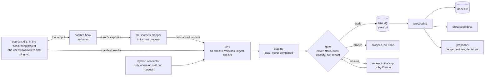
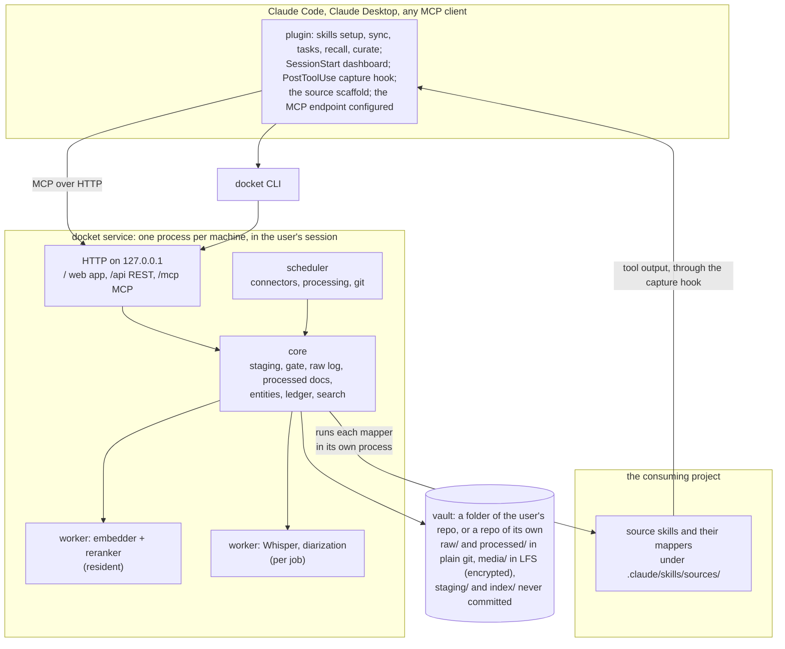

# Docket: the design

Docket is an open-source, Claude-first memory and task manager for one person's working life. It keeps everything they
hear and write at work (mail, calendar, chat, call recordings, Claude sessions, their own documents) twice: **raw**,
exactly as it came, and **processed**, as summaries, notes and a task ledger with meetings, prep, minutes and
follow-ups. On top sit a curated keyword and alias layer, local speech recognition, embeddings and a reranker, and a
web app that runs the day. Claude reaches all of it through an MCP endpoint and a plugin, so any session can find a
sentence said three weeks ago and cite it.

The rule that shapes everything: **a summary is an index into the raw, never a replacement for it.** Read the summary
first, then check every fact you use against the raw it came from. Docket exists because a summary once dropped a
price a colleague named in a call ("10 millió forint"), and only the summary had been kept.

Three parts:

- The vault is the data layer: raw records, media, processed docs, entities and the ledger, in a folder of the
  user's own repo (or a repo of its own), private and in git.
- The service runs it: staging and the gate, the index and search, the web app, the MCP endpoint with its read and
  write tools, the models in worker processes. One per machine, always on, in the user's session. It keeps the source
  contract (record shapes, rid rules, versions) and does the compute: search, transcription.
- The Claude Code plugin feeds and maintains it, through the service's tools: setup, sync, tasks, recall, curate, the
  capture hook and the source scaffold. Its skills write notes and summaries, translate and reconcile, curate the
  keywords and run the ledger; its setup asks what the user wants to set up. The consuming project's own source skills
  do the harvesting, with the user's own MCPs and plugins (see Sources).

The binding choices are entries in `index.yaml` (`uv run docs list decisions`); this page explains how the parts fit.

## 1. What it has to do

| Need | Done when |
|---|---|
| Keep every source raw and processed | every mail, message, event and utterance is in the raw log with a link back to where it came from; every summary names the raw records it covers |
| Summary first, raw for accuracy | every summary line carries an anchor (a record and a time or offset); `verify` pairs each line with its raw span; a correction reaches everything built on the line |
| Keywords and aliases that are kept up | people, projects, customers, sites, products, topics and tickets as entities, with names in each language, nicknames, handles and the ways speech recognition mangles them; upkeep that costs minutes a week |
| Recall that works | a set of real questions finds the right source in the top 10 for at least 90% of them |
| Local speech recognition | Whisper next to the recorder's own transcript, reconciled in context; without a GPU, the source's transcript |
| Embeddings and a reranker | multilingual, behind a provider interface: GPU, CPU, an API, or keyword search alone |
| Sync from anything | call recorders, chat, mail, calendars, Claude sessions and documents; a new source is a skill and a mapper in the user's own project, scaffolded by `docket source new` |
| Memory and tasks | the ledger (owed, waiting, decisions, invites, triage, materials, outcomes), meetings with prep, minutes and outcomes, briefs ready before each meeting |
| Claude first | an MCP endpoint and a plugin with the skills (setup, sync, tasks, recall, curate), the capture hook, the source scaffold and a session-start dashboard |
| In git | everything in the vault is committed after a staging gate; media through LFS, encrypted; the database is rebuilt from what's committed |
| Private stays private | nothing private, uncut or unredacted is ever committed; forgetting removes it for real |
| Local first | Windows, macOS and Linux; every GPU feature optional; no telemetry |
| Several sessions | one service per machine; any number of Claude sessions use it at once |
| Claude inside, optional | on the user's own API key, the service runs processing jobs and the app's buttons without a Claude Code session |

## 2. How big it is

Two hours of recorded calls a working day is about 90 KB of transcript text. A year of raw text from every source is
in the low hundreds of MB, roughly 50 to 100 thousand chunks; a year of audio at 15 MB an hour is about 7.5 GB. That is
small for SQLite and for a GPU (embedding everything again takes minutes) and far beyond any context window, so search
has to be good. Once it has found the right 50 passages, Claude can read all of them in full.

## 3. How it works

### 3.1 Sync, through a staging gate



- Everything lands in `staging/` first, on the local disk, never committed.
- The gate applies, in order: the never-store lists in `vault.yaml` (people, channels, chats, keywords); rules per
  source (a recorder's folder or tag, a work calendar); then, for sources that can carry private content (call
  recordings), a classification by Claude or by the user. Cuts of non-work stretches are applied to the transcript and
  the audio here. Redaction (credentials, phone numbers, the user's rules) runs here on every text, and again on every
  derived text later.
- Only then are records written to the raw log and committed. An unclassified record waits in staging; the app
  shows how many.
- Cursors are a high-water mark plus a lookback window plus a retry set per source, so late arrivals and
  rate-limited calls are caught on the next run. Each machine commits its own cursor file, and a sync starts from the
  furthest point any machine reached.
- Source skills don't retype anything. The plugin's PostToolUse capture hook posts what the source's tools return,
  verbatim, to the service; Claude only sends a run manifest (the window, the counts, what it skipped). The source's
  mapper turns the run's captures into records, and the core checks every rid and computes the versions. A Python
  connector exists only where no skill can harvest (see Sources).

### 3.2 Processing

Each step is idempotent, records the engine and version it used, and can be re-run over everything.

1. Normalize: plain text, language, quoted mail history and signatures stripped (kept in raw).
2. Speech: Whisper, optional diarization, then the two transcripts reconciled in context (see Speech).
3. Chunk (see Search). Both raw transcripts and the reconciled one are chunked; hits on the same stretch collapse.
4. Tag: entities by alias, typed extractors (tickets, amounts, dates), speakers to people.
5. Embed.
6. Link: recordings and chats to meetings by time (the meetings come from the calendar, keyed by the event's id);
   records to the ledger items whose source points at them.
7. Summarize, with Claude: recording notes, thread summaries, digests, each line with its anchors.
8. Propose: ledger items, closes, minutes, decisions, entities and aliases. Proposals go to review in tiers (see Keywords and aliases).

### 3.3 Recall: summary first, raw for accuracy

```mermaid
sequenceDiagram
  participant U as The user or a task
  participant C as Claude
  participant D as docket (MCP)
  U->>C: what did Marco say the consultant would cost?
  C->>D: search("consultant cost", boost people=[marco], since=2026-10-01)
  D-->>C: hits with locators, grouped by recording or thread, each with its summary
  C->>D: read(note, view=summary)
  C->>D: verify(note, lines=[4, 9])
  D-->>C: each line next to its raw span
  C-->>U: the answer, quoted, with locators; a mismatch is said and logged as a correction
```

- `verify` is mechanical because every line carries anchors: `@12:08` within a single-record note, or `[r:<rid>@12:08]`
  when a doc covers several records; `[r:<rid>#2]` points at a paragraph of a mail or message and `[r:<rid>]` at a whole
  record (DR-0110).
- People and entity filters are boosts with a fallback, not hard filters: an unlabelled speaker would otherwise drop
  the very chunk that holds the answer.
- A correction propagates. Every ledger item, decision and brief line records what it was built from
  (`derived_from`). A correction is a new version of the doc (its next rev, DR-0112), and its dependents are flagged
  for review.

### 3.4 Tasks

The ledger keeps owed and awaited items with kinds, triage verdicts (discuss, claude, chase, me), snooze, materials,
notes and an outcome per item, a dated log, meetings with talking points and outcomes, streams, batch operations, and
archiving after closing. Every item's source resolves to a raw record; the history is queryable ("how many asks to
Marco went unanswered"); time-driven changes (rollover, archiving) are written as explicit ops, so rebuilding gives the
same result on any day.

- Meetings come from the calendar. The core turns its records into meeting ops keyed by the event's own id (iCalUId or
  the provider's id), plus the occurrence's original start for a recurring event, so a moved, renamed or cancelled
  meeting updates the same meeting; nothing is matched on start time plus subject.
- A stream can have a status file in the user's repo, rendered from the ledger at a path set per stream in
  `vault.yaml`, with frontmatter `where`, `next`, `deadline` and `updated`. A hand edit to it is reported, not merged.
  Docket renders only into a repo that passes setup's public-remote check.

### 3.5 Beyond search

| Feature | How it works | Phase |
|---|---|---|
| Briefs | a processed doc per person, project and topic: open items both ways, what changed, the last conversations, the decisions; every line cited; rebuilt after a sync for the entities it touched and before each meeting | 2 |
| Decision log | candidates from processing, confirmed by the user; contradictions are marked, never resolved by the machine; a later decision supersedes an earlier one, and history stays | 2 |
| Own documents | the work folder and attachments, read-only, so search covers what was written next to what was said | 1 |
| Highlights | a recorder's highlight button and later a hotkey; marked stretches go to the top of the minutes | 1 |
| Secrets | never in the vault; a keychain-backed `docket secret`, never indexed or sent to a model unless asked for by name | 2 |
| Outbox | drafts Claude prepared, on one page for the user's click; nothing is sent by the app | 3 |
| The user's voice | a recurring edit to Claude's drafts is proposed as a rule into the user's style file | 4 |
| Phone | Today, Queue and Outbox over Tailscale with the owner's identity; never on the open internet | 4 |

## 4. Architecture



### 4.1 The service

- One process per machine, in the user's session, installed by `docket service install`: a task started at logon
  on Windows, a LaunchAgent on macOS, a systemd user unit on Linux. Not a system service: the recorder needs the
  user's audio devices, and the keychain, git credentials and GPU are the user's.
- It serves the web app, a REST API and the MCP endpoint on one localhost port. The plugin registers it with Claude
  Code.
- The single writer. Every Claude session, the CLI and the app go through it, and it serializes writes. If it's
  down, the CLI works on the files with a lock.
- Models run in worker processes, each in its own environment: the embedder and reranker stay loaded; Whisper
  starts per job and ends, freeing its VRAM, and its CUDA libraries never share a process with PyTorch's.
- Security on localhost: bound to 127.0.0.1; the browser gets a session cookie from a one-time link the CLI opens
  (SameSite=Strict); every write checks Origin and Sec-Fetch-Site; the API and MCP take a bearer token from the
  keychain; the MCP endpoint uses the MCP SDK's DNS-rebinding protection. The service runs the consuming repo's
  mappers, never code from the vault, a downloads folder or a drop folder.
- Any number of machines; git is the source of truth. Each machine's index is a cache, rebuilt from the repo. Raw
  run files carry the machine's name, cursors are kept per machine, the machine that harvested a record processes it,
  and a record seen twice is dropped by id and content hash. Ledger ids are ULIDs (with short numbers handed out when
  the ops are folded); op order uses hybrid logical clocks; shared JSONL files merge with `merge=union`. Scheduled
  jobs run on the machine marked primary in `vault.yaml`.
- A commit is local and never touches the network. In a repo of its own, `docket sync` fetches, rebases with
  autostash and pushes; on a conflict it aborts and keeps the local commits.
- In a folder of the user's repo, Docket only makes local commits of the vault's paths. It never fetches, rebases,
  pushes or rewrites that repo: the user's own git flow moves it, and `docket sync` says so and does nothing else.

### 4.2 Without a GPU

| Feature | NVIDIA GPU | Apple silicon | CPU only | No models |
|---|---|---|---|---|
| Speech | faster-whisper large-v3, float16, about 10x real time | whisper.cpp or mlx-whisper | the source's own transcript; turbo int8 overnight as an optional extra | the source's own transcript |
| Embeddings | local model | local model on MPS | small model or an API | keyword search only |
| Reranker | local cross-encoder, 0.6B or smaller | the same on MPS | small model or an API | rank fusion only |

`docket doctor` says what a machine can do and why not.

**Stack:** Python 3.12 and uv; SQLite with FTS5 (and sqlite-vec for vectors); JSONL for the raw log; age for media
encryption; Pydantic for schemas; the MCP Python SDK; FastAPI with server-rendered HTML and HTMX (no front-end build);
faster-whisper; sentence-transformers. MCP servers it launches are pinned to a version.

## 5. The data layer

### 5.1 The vault

The vault is a folder of the repo the user already works in by default, committed into that repo with Docket's
commits limited to the vault's own paths; the setup also offers a repo of its own, for a separate history or remote.
Inside, the layout is the same either way:

```
vault/
  vault.yaml                     the owner, time zone, languages, sources, primary machine, models, redaction, never-store
  staging/                       new records waiting for the gate                          -> never committed
  raw/<source>/<yyyy>/<mm>/<yyyy-mm-dd>T<hhmm>-<machine>.jsonl
                                 one file per sync run, written once                       -> plain git
  media/<source>/<yyyy>/<mm>/<id>.<ext>.age
                                 audio and attachments, encrypted per file                 -> LFS
  processed/<type>/<...>.md      notes, digests, briefs, minutes                            -> plain git
  entities/<type>/<slug>.yaml    the keyword layer                                          -> plain git
  entities/_proposals-<machine>.jsonl                                                       -> plain git
  ledger/ops/<yyyy-mm>-<machine>.jsonl                                                      -> plain git
  state/cursors-<machine>.yaml   each machine's cursors per source                         -> plain git
  index/docket.sqlite            derived; `docket index rebuild` makes it from the above    -> never committed
```

- Setup checks the host repo's remotes before it offers a folder: it refuses one the host reports as public, warns
  when the repo looks shared (other committers), and offers a repo of its own instead.
- Raw text is in plain git, so grep, diffs and partial clones keep working. Only `media/` is in LFS, in both modes,
  so a clone with `lfs.fetchexclude=media/**` can rebuild everything except playback.
- In a folder of the user's repo, init writes the LFS attributes for the vault's `media/` path into that repo's
  `.gitattributes` and checks that git-lfs is installed.
- Media is encrypted, one key per file (age), the keys in the keychain plus an exported backup. Deleting a key is
  what makes forgetting real.
- The database isn't committed. It rebuilds from what's committed; a test checks that two rebuilds give the same
  database (vectors aside).

### 5.2 A raw record

```json
{"rid": "slack:C0EXAMPLE/1791000000.000100", "v": "sha256:...", "source": "slack", "kind": "message",
 "container": "slack:C0EXAMPLE", "thread": "slack:C0EXAMPLE/1791000000.000100",
 "ts": "2026-10-13T12:25:38Z", "author": "U0EXAMPLE", "to": [], "title": null,
 "text": "...", "attachments": [{"name": "...", "kind": "file", "ref": "..."}],
 "native": {"...": "the payload exactly as the tool or API gave it"},
 "fetched": "2026-10-14T13:55:02Z", "via": "slack-plugin-hook", "fidelity": "verbatim", "run": "2026-10-14T1550"}
```

- Ids don't change with the route. Mail uses its Message-ID where there is one; chat uses channel and timestamp.
  Where a route gives no stable id, the id is a hash of sender, sent second, subject and the start of the body, marked
  `fidelity: derived`, and a crosswalk links it to the real id once a better route has it.
- Versions are content hashes of the normalized fields (text, author, attachments), computed by the core and never by
  a mapper; volatile fields such as reactions or reply counts are left out.
- Redaction applies to `native` too: `fidelity: verbatim` means not retyped by Claude, never unredacted.
- A record with a cut keeps no `native`: the core drops it and marks the record `fidelity: cut`, because `native`
  would still hold the cut stretch.
- A recording is one record. Each transcript is its own record (`kind: transcript`, with its engine) and carries its
  utterances in a `segments` field, in the core's shape: a list of `start_ms`, `end_ms`, `speaker` and `text`. The
  index, the gate's cuts, `verify` and rebuilds read that field, never `native`. A vendor's own summary is a
  `vendor-summary` record.
- `rid` is also the ledger's locator, so every ledger source resolves to a record. Older locators (a legacy note's
  path) resolve through the crosswalk.

### 5.3 Processed docs

Markdown with frontmatter, readable in any editor:

```yaml
id: recording-note:2026-10-14-marco-consultant
type: recording-note            # also: thread-summary, digest, minutes, brief, correction, legacy-note
rev: 1                          # the commit that wrote it says: Doc: <id> rev 1
covers:
  - plaud:of_0123456789abcdef
by: claude-opus-5.5, sync 2026-10-14T16:07
supersedes: []
entities: [marco, northwind, fleet-management]
```

Every bullet ends with its anchors. Docs are written through the `doc_put` tool, which checks the frontmatter and that
every anchor resolves before it accepts the doc. A doc lives at `processed/<type>/<yyyy>/<mm>/<slug>.md` when its slug
starts with a date, else `processed/<type>/<slug>.md` (DR-0109). A changed doc is its next rev, and git history keeps
the earlier ones (DR-0112).

### 5.4 The index database

| Table | What |
|---|---|
| `meta`, `run_files`, `problems` | what the index was built with (schema, languages, stemmer), the run files it read, what didn't load |
| `records`, `record_versions`, `crosswalk` | every raw record's current version with its file and line in the raw log, and every version; old and new ids of one thing |
| `segments` | transcript utterances: rid, engine, start and end ms, speaker, person, text |
| `chunks`, `chunks_fts`, `chunk_vec_<model>` | the searchable units; FTS5 over the text as written and a stemmed column per language (DR-0114); vectors per model |
| `docs`, `doc_covers`, `doc_anchors`, `derived_from` | processed docs, the records each covers, each line's anchors, and what each item and brief line was built from |
| `entities`, `aliases`, `alias_terms`, `entity_links`, `external_ids` | the keyword layer loaded from YAML, with each alias's forms and misspellings |
| `mentions`, `extracts` | which chunk mentions which entity; typed values (ticket, amount, date, URL) |
| `items`, `item_log`, `meetings`, `points`, `streams` | the ledger, folded from the op log |
| `links`, `runs` | meetings to records, items to records; sync history |

### 5.5 Retention and forgetting

Prevention first: the gate keeps private, uncut and unredacted content out of git. Retention per source (for example
audio for a year, text forever): for media, expiry deletes the file's key. `docket forget <rid | query>` deletes the
media keys, so the audio is gone for real, rebuilds the index and the docs that cited the record, and shows what it
will touch first. What it does to the text depends on where the vault lives:

| Vault | The text |
|---|---|
| a repo of its own | the raw file's whole history is rewritten without the record (`git filter-repo`, from any machine) and force-pushed |
| a folder of the user's repo | the record leaves the current tree and a tombstone makes rebuilds skip it; Docket says plainly that the text stays in the host repo's history and shows the rewrite command for the user to run |

Docket never rewrites or force-pushes a repo it shares with the user's own work.

## 6. Keywords and aliases

This decides whether recall works on garbled transcripts in two languages, so it gets the most care.

### 6.1 Entities

Types: person, org, customer, project, site, device, product, topic, stream, meeting-series, document, repo, place,
term. Typed extractors catch what patterns catch better: ticket ids, amounts with currency ("10 millió forint" is
10,000,000 HUF), dates and durations, URLs. The file format is DR-0113: besides the fields below, `note` holds free text
and `schema` (absent or 1) guards against a later format.

```yaml
# entities/customer/northwind.yaml
id: northwind
type: customer
name: {en: Northwind, hu: Northwind}
aliases:
  - {text: Northwind Traders}
  - {text: Nortwin, kind: asr}
  - {text: North Wind, kind: asr}
  - {text: Norton, kind: asr, needs: [marco, harbour-site]}   # only with one of these nearby
related: {site: [harbour-site], person: [marco]}
ids: {email_domain: northwind.example}
status: active
```

```yaml
# entities/person/marco.yaml
id: marco
type: person
name: {en: Marco Rossi, hu: Rossi Marco}
aliases:
  - {text: Marco}
  - {text: mrossi}
  - {text: Marko, kind: asr}
ids: {slack: U0EXAMPLE, email: marco@northwind.example}
role: the customer's site lead
```

### 6.2 Matching

- Search columns per chunk, all precomputed: the text as written, accent-folded (`unicode61 remove_diacritics 2`, so
  "hatarido" finds "határidő"); then a Snowball-stemmed column per language in `owner.languages`, English always,
  because a language's stemmer mangles the other's loanwords (DR-0114).
- A word's forms in a stemmed column are its stem, itself, and what its language adds: Snowball cuts a bare Hungarian
  word shorter than an inflected one (`forint` to `forin`, `forintot` to `forint`), so Hungarian adds the stem of the
  word's dative, and for a query word the stem of its stem when the index holds that stem as a word, more often than
  the second cut (`robotot` to `robot` to `rob`, what a bare `robot` holds; not `form` to `for`).
- A compound is one word (`tízmillió`), so `millió` doesn't find it; amounts come with the typed extractors.
- Aliases match as written, and through those forms in the columns of languages that inflect names (Hungarian, not
  English: `Mark` would match `marking`). Each stem form is judged: one under three letters, or one that floods the
  index (`Mark` stems to `mar`, which `már` gives too), is dropped and listed for curation.
- Aliases marked `asr` also match vocabulary words within one edit of a word of 5 to 7 letters, two of 8 or more.
- Aliases with `needs` count only when one of the named entities is in the same chunk.
- A diarized speaker, or an author whose id an entity lists, counts as a mention of that person.

### 6.3 Keeping it up, in three tiers

1. Seed from what exists: a people directory, a glossary, variant lists, the ledger's counterparts.
2. Tier 1, applied by itself (logged, reversible): facts from a system (a chat id, an email address), and a name
   spelled the same by two engines on the same stretch.
3. Tier 2, a weekly batch of at most about 15, ranked by how much the gap hurts search, each with a count, snippets
   and locators. Reviewed on the Curate page or in a `/curate` round; a rejection goes on a stoplist.
4. Tier 3, never shown: one-off capitalized words, rare n-grams.

The dashboard shows review minutes per week, a number to keep down.

## 7. Search

### 7.1 Chunks

| Kind | Chunk |
|---|---|
| transcript | consecutive utterances, about 60-90 s or 350 words, one utterance of overlap; speakers and times kept |
| mail | one message without the quoted history and signature, subject on top; split above 500 tokens |
| chat | one message with its author and channel; plus thread windows (the parent and up to 10 replies) |
| calendar | one event: subject, organiser, attendees, time, response |
| document | one section or slide, with its file and page |
| processed doc | one section, its anchors kept |

### 7.2 One query

1. Read the query: entities expand to their aliases in both languages and their ASR forms; time words ("last week",
   "múlt héten") become a filter; people and entities become boosts.
2. Candidates, filters applied inside each: FTS5 (BM25 over the columns; all words, then any, then prefixes) top 200,
   the vector index top 200, chunks that mention the query's entities.
3. Fuse by reciprocal rank; rerank the top 50 with a small cross-encoder; keep the top k.
4. Group by container (a recording, a thread, a mail conversation), attach its summary, return locators.

Without models, steps 2 and 3 are FTS5 and the mentions, fused by rank (DR-0117). The target is under 1.5 s for k = 20
on a desktop GPU with the models kept loaded; keyword search alone answers in under 0.2 s over 100,000 chunks.

## 8. Speech

The app transcribes, because it needs a local model; skills translate, reconcile and summarize, because that is
judgement.

1. Audio arrives with the recording, decoded by our own code.
2. VAD, then Whisper large-v3 in float16, the language forced where it's known. Hungarian gets a short vocabulary for
   the meeting (its attendees and project).
3. Optional: diarization and speaker names from enrolled voices.
4. The transcript is redacted and stored as its own record next to the recorder's. Both are kept and indexed: a test
   on 38 minutes of Hungarian and English work calls showed large-v3 about as good as a commercial recorder's
   transcript and a little better on names, with different mistakes, so keeping both raises recall on names and
   numbers. The turbo model dropped numbers, so it is only for live use.
5. The two are reconciled in context: aligned by time; the doubtful spots found (disagreements, low-confidence words,
   words close to an alias or a name in the meeting, numbers); each spot gets its context (aliases, glossary,
   attendees, past conversations found by search); Claude decides each spot and returns a list of corrections, not a
   rewrite; low-confidence corrections wait for the user. Every correction is kept with its evidence.
6. Corrections teach Whisper, cheapest first: a vocabulary per meeting; a correction confirmed several times
   becomes an `asr` alias; a LoRA fine-tune once there are 10 to 20 hours of checked material, kept only if it beats
   the base model on held-out stretches.

**The recorder** (phase 4): the microphone and the system audio as two tracks (WASAPI loopback on Windows,
ScreenCaptureKit on macOS, a PipeWire monitor on Linux), Opus at 32 kbps mono; started from the tray, the app or a
`record` MCP tool; a visible indicator all the time.

## 9. Sources

A source's skill and mapper live in the project that uses them; Docket keeps the contract they write to. Routes are
personal (one user's mail goes through a browser because of an access policy, another's through an API) and a vendor's
change lands on whoever uses that vendor, while the core still checks every rid and computes every version.

| Part | Lives in | What it does |
|---|---|---|
| the skill | the consuming project, `.claude/skills/sources/<source>/SKILL.md` | reads the source with the user's own tools (Plaud's MCP, the Slack plugin, mail and chat in the browser); keeps the route's quirks (paging, rate limits, late summaries) in its own files, learned run by run; sends the run manifest |
| the mapper | the consuming project, `mapper.py` and `tests/` next to the skill | code, never a prompt: turns a run's captures into records in the core's shape; the service runs it in its own process, with a time limit and an output cap, from the path `vault.yaml` names for the source, which must resolve under `.claude/skills/sources/<source>/`; the CLI import uses the same one |
| the contract | Docket | the record shapes, a transcript's `segments` among them, which the index, cuts and `verify` read instead of `native`; the rid rules (`<source>:<native id>`, checked on every record); versions computed from the normalized fields, never by a mapper; the ingest checks, holds and the gate; the capture hook and the run manifest |

- A PostToolUse hook in the plugin posts what the source's tools return to the service verbatim, so a long transcript
  never passes through Claude's output; Claude sends a manifest (the window, the counts, what it skipped).
- The hook posts only while a run the skill opened is open, and only for the tools `vault.yaml` lists for the
  source; each capture is tagged with its run, and nothing outside an open run is posted.
- A mapper that runs past its time limit fails the run: its captures are dropped and fetched again, as for a run that
  never closes.
- `docket source new` scaffolds a skill, a mapper and its tests in the consuming repo; setup runs it for each source
  the user chooses.
- Plaud is the reference source, under `examples/sources/plaud` and tested in CI: an example to copy, not a
  dependency.
- Audio is handed over by path or URL, and the service fetches it only within limits:
  - a path under a folder `vault.yaml` names (a downloads folder) or the plugin's own drop folder;
  - a URL over https, to a host `vault.yaml` lists for that source, never a private, loopback or link-local address;
  - a few redirects at most, each checked again, and a size cap.
- Every record goes through the staging gate; a source's sensitivity is in `vault.yaml`.
- A Python connector is written only where no skill can harvest: a scheduled run with nobody's Claude session open.
- Payloads fetched before Docket existed (an export, a backfill folder) are imported from the command line, through
  the source's mapper.

## 10. The web app

| Page | What | Phase |
|---|---|---|
| Search | the same search Claude uses, with facets by entity, source, person and time | 0 |
| Staging | records waiting for the gate: classify, cut, drop | 1 |
| Curate | the weekly batch of proposals | 1 |
| Sync | runs, failures, cursors, rate limits, what needs a Claude session | 1 |
| Settings | sources, never-store lists, models, the Claude API key, a spend cap, redaction rules | 1 |
| Recording | the summary next to the transcript, click a line to read and play it; the two transcripts side by side | 2 |
| Briefs | per person, project and topic; the decision log per stream | 2 |
| Today, Queue, Ledger, Meetings | the day: meetings with briefs and points, triage, items with their raw source one click away | 3 |
| Outbox | drafts waiting for a click | 3 |

Every page has the actions that belong on it. An action runs in the service, runs Claude headless, or hands the job
to Claude Code with the command ready to paste.

## 11. Claude first

MCP tools:

| Tool | Does |
|---|---|
| `search` | query, boosts and filters (sources, people, entities, since, until, k); hits with locators |
| `read` | a locator or doc: the summary, the raw, or both, with `around` (minutes, paragraphs or messages) and a doc's `rev` |
| `verify` | a doc's lines next to their raw spans |
| `timeline` | an entity's mentions by date and container |
| `entity` | canonical name, aliases, related, ids, last seen, open items |
| `doc_put` | write a processed doc; checks the frontmatter and that every anchor resolves |
| `propose` | a ledger item, a decision, an alias, a correction, into the review tiers |
| `ingest` | a run's captures (the hook's verbatim tool output) and its manifest; the source's mapper makes normalized records, the core checks their rids and computes their versions, and they go to staging |
| `media_put` | audio or an attachment by path or URL, within the limits in Sources (named folders, https to the hosts `vault.yaml` lists for the source, no private addresses, few redirects, a size cap); the service fetches, encrypts and stores it |
| `transcribe` | run speech recognition on a stored recording (phase 2, when a model is installed) |
| `ledger` | snapshot, history queries, batch ops, queue, meetings, points |
| `secret` | a named secret, with a confirmation |

The plugin brings the skills (setup, sync, tasks, recall, curate), the SessionStart dashboard, the PostToolUse capture
hook, `docket source new` for scaffolding a source, and the rules: answer with locators; read the summary first, then
open the raw span behind every fact you use; say when they disagree, and propose a correction. The source skills
themselves come from the consuming project (see Sources).

**Claude inside the service** (phase 3) does processing, not harvesting: notes and minutes, digests, briefs,
proposals, meeting prep, draft replies, through the Claude Agent SDK loading the same plugin. It runs on the user's
own Anthropic API key (or Bedrock, Vertex or Foundry), never on a claude.ai login, which third-party products may not
offer. A daily spend cap and a model per job type. What it writes that needs the user's yes is a proposal, replies are drafts, and nothing is sent.

## 12. Importing what exists

No big-bang switch: each piece of an existing setup is replaced only after its replacement has a week of real use.

1. Recordings first: transcripts already fetched go through the gate into the raw log.
2. An existing notes folder stays, frozen and read-only. Its notes become `legacy-note` docs that keep their old
   paths as aliases, so every reference to them still resolves.
3. Entities are seeded from the people directory and the glossary, then reviewed in a few curate rounds; after
   that, those files are rendered from the entities.
4. The ledger moves last, imported with its whole history; for a week both run in step, the old one read-only.
   Until the day pages exist, an existing setup's sync harvests through its own source skills into Docket and keeps
   reconciling into its own task list. Once the ledger has moved, each stream's status file is rendered from it, as
   the people directory and the glossary are from the entities.

## 13. How we know it works

- Recall: a set of real questions with the right locators; recall@10 and MRR, run by `docket eval` after every change
  to chunking, models or aliases.
- Speech: hand-corrected stretches; word error rate and name error rate.
- Software: a synthetic fixture vault; a test that two rebuilds give the same database; recorded replays per
  connector; property tests that merging two machines' ledger ops gives one result in any order; structured logs per
  run and job.

## 14. Phases

| Phase | What | Usable for |
|---|---|---|
| 0 | the vault and its raw log behind the gate; recordings and old notes imported; full-text search with a column per language and seeded aliases; a minimal service with MCP `search`, `read`, `verify`, `doc_put`; the Search page | finding anything already kept, with sources, from any Claude session |
| 1 | syncs write raw through the gate; the capture hook; embeddings and a reranker in a worker; the question set; curate tiers; own documents; highlights; the Staging, Curate, Sync and Settings pages | recall on Hungarian and paraphrased questions; every source raw |
| 2 | Whisper with encrypted media; reconciling transcripts in context; vocabulary and learned corrections; Claude sessions as a source; briefs; the decision log; corrections that propagate; the secret store; retention and forget; the Recording page | prep from ready briefs; decisions with sources and history |
| 3 | the ledger and the day pages (Today, Queue, Ledger, Meetings, Outbox); GitHub and Azure DevOps activity; scheduled connectors and Claude inside the service | daily use; syncs without a session |
| 4 | the recorder; a Whisper fine-tune; learning the voice; the phone page; diarization if wanted | calls on the laptop without a recorder device |
| 5 | installers on macOS and Linux; Gmail and IMAP; docs; the first release | giving it to friends |

Kept out on purpose: a meeting copilot that speaks during calls, anything that sends without the user's click, a
multi-user server, a native phone app, GraphRAG.

## 15. Risks

- Private content: the gate is the control; a misclassified recording is caught in staging, not after a push.
- Review load: if the weekly minutes climb, the tiers' thresholds go up first.
- Speech: Hungarian and accented English accuracy; measured before we depend on it.
- The Windows GPU stack: CUDA libraries clashing; worker processes and `docket doctor` contain it.
- Scope: dogfood first, generalize what proved itself, friends at phase 5.
- Model churn: the engine and version on every derived artifact, and rebuilding.
